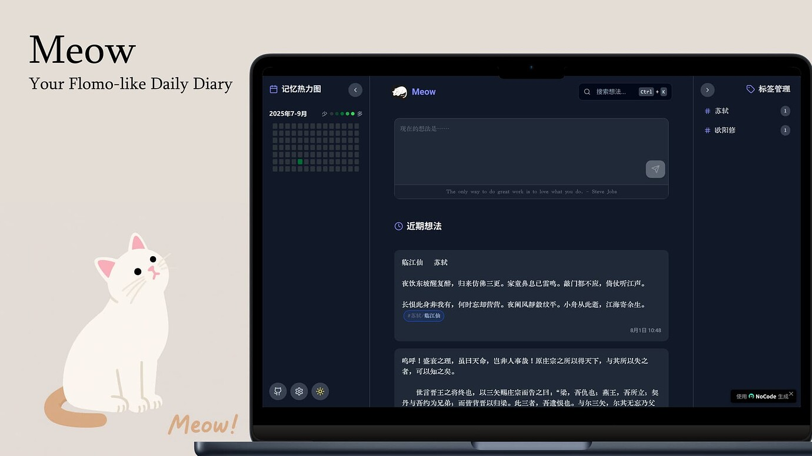

# Meow

自部署的笔记、画布、每日回顾与音乐工作区。新版采用 React + 严格 TypeScript、Express 和 SQLite，保留原界面、主题、动画与交互，以新的契约、身份、持久队列和媒体存储重写实现。



只支持正常本地开发、构建后 Node 运行和 Docker。**这是独立的新版本，不直接使用旧 Meow 数据库、浏览器存储、配置或备份。** 不会自动迁移或清理旧数据。Cloudflare/D1、Supabase、Electron 及客户端 S3 平台支持已退役。

## 本地开发

使用 [.nvmrc](.nvmrc) 指定的 Node.js 22.23.4：

```sh
nvm install
nvm use
npm ci
```

参照 [.env.example](.env.example) 创建自己的 `.env`，不要覆盖已有配置。至少设置新的 `MEOW_OWNER_PASSWORD`（12–1024 字符），并为 `MEOW_DATA_DIR` 指定**独立空目录**，默认 `./data-v2`。

模板不含实际密码或 API 密钥。网页登录只使用 `MEOW_OWNER_PASSWORD`：在自己的 `.env` 中取消该行注释并填写密码，再重启后端；未设置时仅可公开浏览，不能登录。`MEOW_AI_API_KEY` 是可选的 AI 服务商密钥，与登录无关。旧版 `PASSWORD`、`APP_PASSWORD` 和 `VITE_SUPABASE_*` 已不再读取，不要继续使用。

```sh
npm run dev:local
```

访问 `http://127.0.0.1:8080`；API 默认 `127.0.0.1:3000`。只启动前端用 `npm run dev`，只启动开发 API 用 `npm run server:dev`。更改 API 端口时统一设置 `MEOW_PORT`，Vite 会代理到对应端口。

## 构建后运行

```sh
npm run check
npm start
```

`check` 执行严格类型检查、零 warning lint、行为测试和生产构建。`build/` 是前端，`dist/` 是后端；`npm start` 用同一 Express 应用服务页面、API 和媒体。访问 `http://127.0.0.1:3000`。`npm run preview` 仅预览前端，仍需另启 API。

运行数据位于 `MEOW_DATA_DIR`：`meow-v2.sqlite`（含运行时 WAL/SHM）与 `uploads/`。目录必须是空目录或已识别的新版实例；误配旧库/未知非空目录会拒绝启动。一个数据目录仅由一个 Node 进程或一个容器副本独占，不支持共享卷多副本写入。不要把真实数据放进仓库或构建上下文。

## Docker

复制示例为独立的 `.env.v2` 并填写自己的新口令。镜像使用同一 Node 版本和业务代码，以非 root 用户运行：

```sh
docker compose --env-file .env.v2 up -d --build
docker compose --env-file .env.v2 ps
```

默认仅绑定 `127.0.0.1:3000`；用 `MEOW_HTTP_PORT` 修改宿主机端口。命名卷 `meow-v2-data` 挂在 `/data/meow-v2`，保存数据库和实际附件。正常更新可重新 build/up；**不要用 `down -v` 更新或修复真实实例**。

对外部署在 HTTPS 反向代理后设置 `MEOW_PUBLIC_ORIGIN=https://你的域名`，保持同源；生产 cookie 使用 Secure。开发使用 localhost/loopback，其他不安全 HTTP origin 无法完整使用可信会话与浏览器写入锁。`/api/health` 检查数据库就绪，正常返回 `status: ready`。

## 配置与数据保障

- AI：服务端同时设置 `MEOW_AI_BASE_URL`、`MEOW_AI_API_KEY`、`MEOW_AI_MODEL`；再在原设置界面启用 AI。前端不接收 API key，可选择模型及明确要发送的笔记上下文。
- 音乐搜索/解析、背景、一言可用 `MEOW_MUSIC_SEARCH_URL`、`MEOW_MUSIC_RESOLVE_URL`、`MEOW_BACKGROUND_URL`、`MEOW_HITOKOTO_URL` 配置，留空关闭。外部服务异常不会阻断本机草稿或正常笔记操作。
- 附件默认由自己的文件卷保存。单文件最多25 MiB；媒体访问根据当前引用授权，支持 Range。外链音频仍依赖原服务，不能当作已经备份的文件。
- 设置“数据”页可导出完整新版包、恢复到空的新实例或预检外部 Memos SQLite。完整包上限128 MiB，含全域业务配置和实际托管附件；超限/缺文件明确拒绝。[完整备份与恢复说明](docs/backup-and-restore.md)。
- 同一浏览器 origin、实例和主体只有一个可写标签页；其他页显示只读，写入页关闭后自动接管。离线 writer 的草稿/待提交项保存在本机，重连验证身份后继续；它们尚未同步时不包含在服务端备份内。
- 退出/401 立即隐藏私有区域；本机待提交内容隔离保留供重新登录恢复。共享设备使用者需理解这不等于对浏览器磁盘数据进行加密。

开发规范见 [AGENTS.md](AGENTS.md)，结构和数据流见 [architecture.md](docs/architecture.md)，契约见 [api.md](docs/api.md)，阶段及实测证据见 [implementation-status.md](docs/implementation-status.md)。
