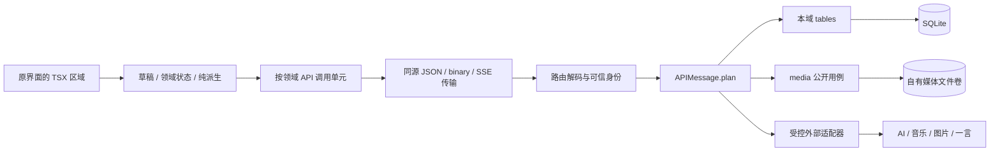

# Meow 架构与数据流

更新：2026-10-24。本文描述完整重写后的实现；实际验收、未测环境和阶段状态集中记录在 [实施与验收记录](implementation-status.md)。[计划表](refactoring-plan.md)规定完整交付范围，[AGENTS.md](../AGENTS.md)规定持续开发约束。重写前的源码分析保存在[历史盘点](decisions/0000-original-assessment.md)，不作为当前入口说明。

## 1. 已确认的产品与技术边界

- 以现有 server 的 Node/Express/SQLite 技术基础重建唯一后端，前后端严格 TypeScript；一个进程、一个数据库和一个媒体卷构成模块化单体。
- 用户明确保留原有界面和视觉效果，只升级实现。三栏、移动抽屉、编辑器、卡片、热力图、标签、画布浮栏、设置/回顾/AI 弹窗、播放器、主题/字体/动画均以旧版呈现为基线。退役平台专属配置移除，必要的身份、离线、冲突及恢复反馈明确展示。
- 完全重写，不兼容旧 Meow API/DTO/数据库/配置键/浏览器数据/备份；不建设旧库迁移、双写或旧版本回退。代码退役不授权删除真实旧数据、profile 或远端资源。
- 运行方式只有本地 Vite+Node 开发、构建后 Node 同源服务和 Docker。Cloudflare Pages/Worker/D1、Supabase、Electron 及客户端 S3/R2 平台选择器退役。第三方 AI/音乐/背景/一言仍是产品集成。
- 单工作区 owner/anonymous，不新增注册或多用户隔离。匿名可以浏览公开笔记及公开外观，不能读取私有领域数据。

## 2. 业务域、表归属与依赖

| 拥有者 | 数据与表 | 公开用例/职责 |
|---|---|---|
| system | `meow_schema`、`meow_migrations` | 实例 ID、格式及有序迁移记录；连接、同步工作单元、HTTP、安全网络基础设施 |
| identity | `identity_credentials`、`identity_sessions` | 初始化口令哈希、会话查询、登录/退出、可信主体与活动会话检查 |
| memos | `memos`、`tags`、`memo_tags`、`memo_links`、`memo_pins`、`memo_attachments`、`memo_tombstones`、`memo_sequence`、`memo_operations` | 笔记 CRUD、置顶、公开性、标签/双链及公开投影、增量变化和幂等回执 |
| preferences | `workspace_preferences`、`preferences_operations` | 外观及私有功能配置、公开外观投影、条件更新 |
| canvas | `canvases`、`canvas_operations` | 画布形状、viewport、笔记位置、版本与幂等；笔记内容继续归 memos |
| review | `review_results`、`review_operations` | 按 memo+业务日+时区保存 PASS/FAIL，条件更新和整组原子重置 |
| music | `music_tracks`、`music_library`、`music_tombstones`、`music_operations` | 自定义曲目、顺序、歌词/弹幕、媒体或外部音频来源；播放进度不入库 |
| media | `media_assets`、`media_references` 与 uploads 文件 | 稳定 mediaId、真实文件、MIME/大小/hash、ready/deleting、资源引用与可见性 |
| transfer | `transfer_batches`、`transfer_leases` 与暂存目录 | 完整备份、空实例恢复、fenced lease/清理恢复、外部 Memos 预检及导入批次 |
| integrations | 无业务表 | 受控 AI SSE、音乐搜索/解析、图片导入、背景、一言和固定仓库统计 |

`server/services/<domain>/{api,objects,routes,tables,utils}` 就近组织。主要对象按概念拆文件；DTO 在 shared/contracts，数据库行在表模块显式映射，objects 不读网络、数据库、时间或随机数。SQL/参数/行映射只归 tables；已发布迁移不随意改写历史。

依赖为 `routes → APIMessage.plan → tables / 域内纯函数 / 其他域公开 API`，底层可以使用 system 和共享纯 schema。system 不导入业务域；`server/bootstrap.ts` 是组合根。它将 memo 删除协调为画布/回顾引用删除和媒体引用更新，将 preferences/canvas/music 变化协调为 media 引用更新，复用同一个数据库工作单元。领域之间没有直接写对方表。

内部 API（领域快照、Restore、资源引用、授权断言等）没有 HTTP 路由。公开调用契约与权限、输入/响应、错误、事务和前端位置见 [API 清单](api.md)。

## 3. 页面区域与状态所有权

| 区域/模块 | 核心状态 | 纯派生或外部同步 |
|---|---|---|
| App / Login | 会话 loading/ready/error、登录弹窗、离线未验证 | 统一会话 API；401 即时隐藏私有区域；登录入口保持原弹窗 |
| Index / useWorkspace | 已确认 memo、持久草稿、outbox、增量游标、写入权 | 搜索/标签/日期过滤、反链、字数/数量/热力图从核心数据计算 |
| 原 Header/侧栏/卡片/编辑器 | 当前编辑 ID、菜单/分享/预览/教程显隐 | 页面纯展示映射 MemoView；不恢复旧 Context 或整包同步 |
| Canvas | 版本化 document、本机待提交快照 | 几何转换和工具预览；memo 内容经主工作区同一操作入口 |
| Preferences | 后端配置及其 revision，设置表单草稿 | dark class、原 CSS token、自定义字体和背景效果 |
| Review | 当前业务日/时区、结果、当前卡片与翻面 | 随机/日期池和进度；PASS/FAIL 使用服务器合同 |
| Music | 后端曲库，唯一 audio 播放实例 | 原迷你/全屏只是同一实例的视图，歌词跟随时间；内置曲目为静态产品资源 |
| 设备状态 | 快捷键、侧栏固定、匿名主题、音量/进度/循环/歌词显隐 | 新实例命名空间；播放器再按主体隔离；不写业务配置或跨设备覆盖 |
| PendingMediaStore | IndexedDB 中真实 Blob、稳定 ID/operationId、上传状态 | 展示 Object URL 只用于当前生命周期，卸载后释放 |

前端 API 在 `src/apis/<domain>/`，传输在 `src/system/api/`。请求取消、cookie、X-Meow-Request、统一错误和 401 会话事件在发送边界处理。页面不拼接业务 HTTP 协议；静态资产和媒体 content URL 属于资源呈现。

筛选 query/tag/date 放 URL，刷新可恢复。派生结果不另存 state。SSR 不属于本版本；可直接访问的页面路径由 Node 静态回退支持。新 localStorage 命名空间 `meow:v2:<instanceId>:<principal>:...` 与独立 IndexedDB 不读取/清空旧键。

同一 origin、实例和主体同时只有一个页面持有 Web Locks 写入权；其他页面明确只读并观察持久状态，写入页关闭后接管页面先重读再同步。离线与只读是独立状态：离线 writer 可以保存本机草稿，reader 不得写队列或画布。浏览器无 Web Locks 或不处于安全上下文时安全只读；部署须使用 HTTPS，开发可用 localhost/loopback。

## 4. 用户操作与数据流

### 4.1 新建、编辑及同步

1. 输入首先写持久草稿；保存前生成稳定 memoId/operationId，将变更意图写入 outbox，成功持久化后才发请求。
2. writer 顺序提交同一实体操作。编辑开始时捕获 baseRevision；同步刷新不会偷偷替换草稿的编辑基线。
3. 路由验证 schema、可信 owner、工作单元，再执行用例。memo/标签/双链/置顶/媒体引用在同一事务提交。
4. ACK 后更新已确认实体、移除对应待提交意图，并给后继操作接上已确认 revision。400/413 阻塞该实体并允许修正；409 保留本地文本和远端版本，明确选择后再提交。
5. owner 用 `/api/memos/changes` 的全局序列读取更新和删除记录；分页不存在不能当作删除。匿名重新取公开列表，不能得到私有变化序列。

断网/未知响应不丢操作，重试复用相同 operationId；相同 ID 不同 payload 409。删除有 tombstone，离线重试不会复活已删笔记。变化流确认远端删除时，现存编辑草稿与删除标记原子保留并展示恢复入口；只能显式转到新草稿，不能覆盖已有新草稿或自动重建原 ID。列表和画布编辑共用工作区草稿。退出或任何发送层观察到 401 时停止私有呈现，草稿/队列隔离保存，重新认证后恢复。

### 4.2 录音、上传及引用

1. 文件/录音先保存真实 Blob 到独立 IndexedDB；保存失败不在草稿里挂假附件。
2. 上传以固定 ID/op 流式进入 `.staging`，限制 25 MiB，校验 MIME 魔数并计算 SHA-256；用排他的文件链接发布，不能覆盖未知同名文件。进程中断留下的同名普通文件只有大小和 SHA-256 完全匹配时才复用；已确认 metadata 的缺失文件可用原 operation 和保留的 Blob 修复。
3. 长文件读取结束后进入应用实例共享的 `filePublication` 异步锁，重新验证会话，发布文件并用短事务写 metadata；提交失败的文件补偿在释放锁前完成。上传、无引用删除、恢复（含重试清理）共用这把锁，防止失败请求删除后来请求已确认的同名文件。文件接收、外部网络和包解析不占用该锁。随后业务用例验证 kind/MIME，建立引用。
4. 业务 ACK 后释放本机暂存；冲突/失败时保留以便重试或下载。图片 URL/随机背景也通过受控后端获取并保存为 mediaId。
5. 读取以当前引用决定可见性，支持单 Range 206/416。最后一个公开引用撤销后立即停止新匿名读取；响应 private/no-store。只有无引用资产可标为 deleting 后清理，失败独立重试。

默认文件限额不能把 Base64/Object URL 当永久资源。音乐外链是显式 external 来源，备份只含地址并列出未打包项；上传的音频/图片是实际备份字节。支持 FLAC、WAV、MPEG、OGG、WebM、MP4 等声明的音频 MIME，详细白名单以 media schema 为准。

### 4.3 画布、回顾与设置

画布只保存布局和形状，不复制 memo 真相。memo 删除通过组合根在同一事务去除画布/回顾/媒体引用。Canvas 的本机文档与队列服从同一 writer 权限，条件保存不覆盖新 revision。

回顾业务日期明确带 IANA timezone，不以设备时钟比较版本。默认时区为 Asia/Shanghai；切换时区得到对应业务日。整组重置在一个工作单元中校验并更新，不能部分 PASS/FAIL 成功后假报全部完成。

外观设置有条件 revision；公开投影只含原界面需要的外观，不包含 AI 开关/model、私有时区和曲库。原随机背景“收藏”只把当前 mediaId 设为固定背景，不再下载另一张图片。

## 5. 身份、错误与外部边界

- 口令只来自服务端环境配置，以 scrypt 保存哈希。客户端不保存口令；会话随机 token 仅 HttpOnly/SameSite=Strict cookie，数据库存哈希，支持到期和撤销，生产使用 Secure。
- 按用户要求，工作区口令不设专用长度或复杂度门槛，配置读取与共享登录契约接受任意非空密码；未设置或留空时关闭 owner 登录，仅可公开浏览。通用 HTTP 请求体大小限制仍适用。
- 写请求要求 X-Meow-Request=1，检查 Origin；不开放任意 CORS。路由显式 public/owner，未声明权限拒绝注册。共享口令拥有者是整个工作区 owner，不宣称逐用户资源隔离。
- 公开 memo 的 links/backlinks 只投影公开目标，私有笔记不可通过搜索、预览、标签、AI context 或媒体 URL 绕过授权。
- 统一错误 `{error:{code,message,requestId,details?}}`；400/401/403/404/409/413/429/5xx 分类，500 通用文案。只允许已知冲突 details 返回安全 DTO，日志仅记录可关联的状态/code/requestId，不打印 SQL、堆栈或秘密。
- Markdown/允许的原始 HTML 经过 sanitize；禁止 script/危险 URL/事件属性。CSP 限制脚本和连接同源，允许原字体/图片/音频资源的 HTTPS 呈现。
- 外部请求只允许不含凭据的 HTTPS；解析所有 DNS 答案并拒绝本机/私网/保留地址，将通过的 IP 固定到 TLS 请求且校验证书主机名。每次重定向重验、跨 origin 去凭据；限制 DNS/总超时、跳转、响应大小，支持取消。
- AI key/base URL 仅后端配置，默认模型由服务端配置，owner 可在私有设置中指定模型；公共投影不带 aiEnabled/aiModel。前端得到配置状态及模型名；只发送用户明确选择的 context memo。上游 SSE 解析碎片 UTF-8，归一为 delta/done/error，缺少 DONE 是失败，取消保留已收到的草稿。
- Fake-IP 代理环境可能返回 198.18/15 等保留地址，安全拒绝并回退一言文案；不为通过验收放开内网。可由运维配置独立 DNS，实际外部服务与合成上游测试证据分别报告。

## 6. 事务、并发与容量

SQLite 单进程使用 foreign_keys、WAL、busy_timeout；工作单元以同步 immediate transaction 执行。返回 Promise 的工作单元拒绝提交，不在事务中等待网络或大文件；响应 DTO 在提交前校验，错误回滚。唯一约束、条件 revision、operation payload 指纹保证幂等和并发冲突语义。

每个 `MEOW_DATA_DIR` 必须由单个 Node 进程/单个容器副本独占；`filePublication` 是应用实例内锁，不是跨进程文件租约。多实例共享一个 SQLite 文件或 uploads 目录不是支持的扩容方式。首版以有界分页和包限额提供可说明的能力，不声称任意容量：memo 列表/changes 每页最多100，自定义曲库每页最多500；画布最多1000形状/5000笔记位置；单媒体25 MiB、外部图片10 MiB、完整包128 MiB、单包最多5000 memo/5000 assets。达到限额明确拒绝，不生成缺内容的“成功”包。完整 schema 给出各数组/内容长度限制。

文件副作用与数据库无法组成同一个 OS 事务：上传和恢复采用暂存、排他发布、短事务及补偿/journal。数据库提交后的清理失败标为 cleanupPending，不假称回滚；恢复 lease 防止过期操作者继续提交。

## 7. 新版备份、恢复与外部导入

完整包为未压缩 JSON：`manifest + entities + assets`，formatVersion/schemaVersion、来源实例、时间、计数、文件大小/hash 和领域引用都校验。数据库实体在同一同步快照读取；文件以稳定 ID 和 hash 验证，丢失/变化即拒绝导出。包不含口令、会话、API key、操作回执或设备播放偏好；外部音乐地址明列未包含字节。

恢复只接收空的新实例：预验证全部 schema/计数/hash/引用/公开性，文件暂存后排他发布，调用各域 Restore API 在一个工作单元落库。重复 backupId 幂等；故障根据 journal/lease 回收或重试。完整恢复保留业务 ID/revision/time/order，目标实例拥有新的 instanceId，避免浏览器误继承来源缓存。运维流程见 [备份恢复说明](backup-and-restore.md)。

外部 Memos 导入是独立产品能力，不是旧 Meow 兼容：支持声明的 `memo(id,content,created_ts)` 一致性 SQLite 快照，可选 updated_ts、payload.tags、pinned、visibility、row_status、resource/memo_resource。只读预检数量和缺失附件，用户核对后导入；来源 hash/批次和确定性新 ID 去重。未知 schema、单独 WAL/SHM、活动 WAL 不完整副本明确拒绝；没有提供的资源列出报告，不伪造为已导入。

## 8. 退役与保留矩阵

| 对象 | 当前处置 | 保留边界 |
|---|---|---|
| 旧 src/server JS/JSX、整包 Context/D1 客户端 | 从新入口可达图核验后移除 | Git 历史与静态盘点保留，不重建兼容桥 |
| functions/api、Worker、Wrangler、D1 SQL、Supabase残留 | 退役 | 不操作已部署云资源 |
| Electron main/preload、桌面代码/脚本/依赖/说明 | 退役 | 不删除用户安装/profile；浏览器共享静态资产保留 |
| 客户端 S3/R2/MinIO 凭据/平台选择 | 自有 media 卷取代 | 第三方 AI/音乐等服务适配继续存在，秘密仅后端 |
| 原主题/CSS/SVG/图片/字体/emoji/教程资源 | 保留并用于严格 TSX 呈现 | build/dist 由构建生成，不手工维护 |
| 自动同步上游/强推镜像仓库 CI | 退役 | 新质量 CI 使用 npm ci + npm run check |
| 旧真实 DB、浏览器键与云桶 | 未迁移/改写/清理 | 新版误配非空未知目录/库时拒绝启动；秘密不进入文档、日志与产物 |

## 9. 决策差异与验收入口

课程参考 Scala/Cats Effect/http4s/PostgreSQL/Zustand 不作为机械换栈要求；本项目采用 TS/Express/better-sqlite3 和职责明确的 React hooks/Context。Promise 是立即执行，不宣称等同惰性 IO。SQLite 没有 PostgreSQL 行锁，使用 immediate transaction/条件 revision。模块内调用和单体部署保留，不形式化微服务。

`bootstrap.ts` 为真实跨域工作流提供显式钩子，是组合根必要例外；路由保持薄，内部 Export/Restore/资源引用用例不暴露为公共端点。原界面保留通过 TSX 原呈现层实现，没有恢复旧存储/认证/同步实现。

完整验收索引见[计划表第4节](refactoring-plan.md#4-验收用例索引)。类型、lint、自动行为测试、生产构建、浏览器视觉/交互、实际 Docker 与外部服务验证分别记录；文档中的已实现结构不等同于所有环境已经实测。
