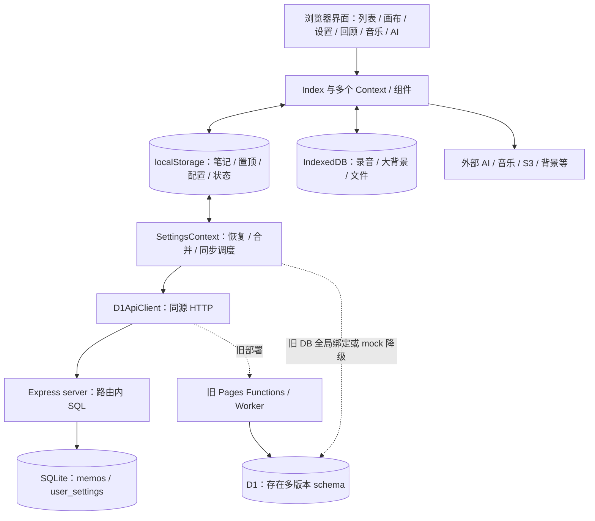
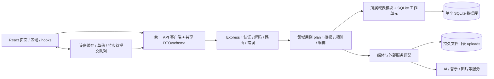

# 重写前静态盘点归档

以下保存重写前的分析与设计过程。正文中的“当前”“本轮”和未实施状态均指当时的盘点，不表示新版本当前状态；执行规范和已实现架构见 [architecture.md](../architecture.md) 与 [AGENTS.md](../../AGENTS.md)。

历史源码基线为 Git 提交 `d05d69c05f3abbb6744949c6d97adedf28d7c688`。已退役源码以普通历史路径标注，可在仓库中使用 `git show d05d69c05f3abbb6744949c6d97adedf28d7c688:<path>` 查看；不把已删除文件伪装成当前源码链接，也不假定该提交可从远端访问。

# Meow 架构与数据流基线

源码盘点日期：2026-10-23；设计修订日期：2026-10-24。状态：**旧版现状为源码静态核验；不兼容旧版本的完整重写正在实施，实际证据见 [implementation-status.md](../implementation-status.md)。** 分阶段改动范围、依赖、失败恢复和验收表见 [refactoring-plan.md](../refactoring-plan.md)。开发约束见 [AGENTS.md](../../AGENTS.md)。

本轮未运行应用、浏览器、Electron、Docker、构建或测试，未读取 `.env`、真实数据库、浏览器存储或线上数据。文中的缺口是可定位的代码事实或据此提出的风险，不代表已在真实环境复现；外部服务是否可用仍需实施阶段核验。旧实现用于提取产品需求与失败场景，不是新版本的兼容合同。

## 1. 范围与已确定决策

| 编号 | 决策 | 状态与影响 |
|---|---|---|
| D01 | 以本仓库现有 `server/` 为自有后端基础 | 用户已确认；不接入未知独立服务，不新建分布式后端 |
| D02 | 退役 Cloudflare Pages、Workers、D1 及其他替代业务后端支持 | 用户已确认；新版本仅提供自有后端，不开发旧平台兼容或迁移桥 |
| D03 | 同时退役 Electron 打包、主进程、preload、桌面专属 UI/分支 | 用户已确认；保留浏览器产品能力，不要求桌面 profile 导出或承接 |
| D04 | 只支持本地正常开发/Node 运行与 Docker | 用户已确认；两者使用同一套 API、应用用例与数据库语义 |
| D05 | 沿用 Node + Express + SQLite 技术基础，前后端按新设计采用严格 TypeScript | 本计划的实施基线；重写目录、模型与契约，无需为课程示例切换 Scala/PostgreSQL |
| D06 | 后端为业务数据权威来源，浏览器只持缓存、草稿、待提交项和设备偏好 | 目标设计；替换当前双向整包覆盖，保留可恢复的离线编辑能力 |
| D07 | 自有后端管理附件元数据与本地文件卷；第三方 AI/音乐等保留为集成 | 首版推荐方案；不重建客户端 S3/R2 平台选择，不承接历史资产 |
| D08 | 单工作区 owner/anonymous 权限模型 | 目标设计；保留共享实例形态，增加真实服务端会话，不凭空扩展多租户/注册系统 |
| D09 | 完整重写，不考虑旧版本兼容 | 用户于2026-10-24明确；旧API/DTO、配置、数据库、浏览器键、备份格式与客户端均不构成约束；不实现旧数据转换、双写、兼容层或旧版本回退 |

D09 取代上一版计划的渐进兼容迁移路线。本轮同步修订 AGENTS 与两份设计文档；新版本从独立的新库、文件目录与浏览器存储命名空间启动，不自动加载或改写旧数据。旧数据接入不在当前交付范围，也不是退役代码的前置条件；删除真实数据库、云资源、已安装应用或 profile 不属于这次文档修订。分阶段实现是管理范围与验证质量的方式，不要求任何中间阶段向旧客户端提供服务。

**保留**：笔记与内容编辑、标签/检索/统计、反链、公开访问、画布、回顾、分享图、音乐、AI、主题/设置、导入导出与数据恢复。**明确退出**：Cloudflare 部署/数据库适配、Supabase 残留配置、Electron 原生窗口/菜单/打包。**不自行增加**：多用户注册、微服务、消息队列、事件溯源、完整 PWA、AI 对话持久历史。

## 2. 当前系统结构

### 2.1 入口与职责

| 层/区域 | 当前实现 | 主要问题或边界 |
|---|---|---|
| 启动/路由 | `src/main.jsx` → App；HashRouter 仅 `/`、`/login` | 其他功能是首页区域/弹窗，不是独立路由 |
| 全局提供者 | QueryClient → PasswordAuth → Theme → Settings → Music | React Query 目前仅 Provider，未发现 `useQuery/useMutation` 消费，不能称为既有服务端缓存层 |
| 首页 | `src/pages/Index.jsx` 管笔记/置顶/筛选/画布/侧栏/弹窗/AI请求 | 业务、持久化、外部副作用与 UI 耦合，1561 行（本次快照） |
| 设置/同步 | SettingsContext 管配置、本地键、启动恢复、定时与手动同步 | 988 行；同步、身份可见性、媒体恢复与偏好生命周期混杂 |
| 展示/编辑 | MemoEditor、MemoList、ContentRenderer、CanvasMode、SettingsCard 等 | 多个组件操作同一业务规则与存储；CanvasMode 约1691行，SettingsCard 1570行 |
| HTTP 客户端 | `src/lib/d1-api.js` 的 D1ApiClient | 实际是同源 `/api` 客户端，仍被旧入口调用；重写入口无依赖后随旧调用者删除 |
| 旧直接绑定 | `src/lib/d1.js` 的 D1DatabaseService | 依赖全局 `DB`，普通浏览器未发现注入者；有失败降级与开发 mock，不代表可用后端 |
| 自有后端 | `server/index.js` + config + database | Express 路由内直接 SQL/业务/编码；启动即建库并 listen，测试隔离困难 |
| 旧平台后端 | `functions/api/` 与 `worker.js` / `_worker.js` | 两套接口、schema 不完全一致；无法由仓库判断线上实际在用哪套 |
| 数据/资产 | localStorage、IndexedDB、SQLite/D1、S3/URL/Base64 | 多写者、部分完整副本、部分仅引用；备份范围不完整 |
| 外部集成 | AI、音乐搜索/解析、背景、一言、字体等 | 多处浏览器直接 fetch；自有后端缺背景代理等替代能力 |

证据：入口与 Provider（`src/App.jsx`）（L18–73）、路由表（`src/nav-items.jsx`）、首页（`src/pages/Index.jsx`）、设置与同步（`src/context/SettingsContext.jsx`）、当前 HTTP 客户端（`src/lib/d1-api.js`）。

### 2.2 当前架构图



虚线表示旧适配或假设绑定，不表示当前环境实际连通。Electron 只是加载 Vite/build 的另一客户端入口，没有启动 `server/`；其数据属于独立浏览器 origin，不是配置文件提到的某个已实现桌面 SQLite。

### 2.3 当前运行与部署

| 模式 | 路径 | 当前限制 |
|---|---|---|
| 开发 | `npm run dev:local`：Vite 8080 + Express 3000；`/api` 代理到后端 | `.nvmrc` 推荐22；`server/config.js` 默认 HOST 为 `0.0.0.0`，示例环境才设本机地址 |
| 构建后 Node | `npm run build` → `build/`；`npm run server` 同源托管 | 服务端优先已存在的 `dist/` 再 `build/`，产物来源需统一 |
| Preview | Vite preview + 独立运行的 API | 只启动 preview 不能验证后端 |
| Docker/Compose | Node20 Alpine 两阶段；`build` 复制为 `dist`；SQLite 位于 `/data`；非 root 执行 Node | 与本地 Node22 不一致；npm install 非严格锁安装；仍复制 D1 SQL；缺健康检查；构建上下文未排除 `data/`/SQLite/附件 |
| 旧 Cloudflare | Pages 文件路由 / Worker入口 + `env.DB` | 接口与 schema 分叉；计划退役 |
| 旧 Electron | 主进程加载 Vite 或 build HTML，preload 暴露窗口/菜单/标记 | 不打包自有后端；原生菜单事件未发现完整 UI 接收链；计划退役 |

证据：package（`package.json`）、Vite（`vite.config.js`）、server配置（`server/config.js`）、Dockerfile（`Dockerfile`）、Compose（`docker-compose.yml`）、入口脚本（`docker-entrypoint.sh`）、忽略规则（`.dockerignore`）、桌面主进程（`public/electron.js`）。

## 3. 功能基线与保留范围

“存在”表示源码调用链可达，非运行验收；新版本据此提取能力与失败场景，以合成数据验收。用户已明确保留原有界面和视觉效果，只升级实现。布局、主题、字体、组件、动画、响应式与交互以旧版为呈现基线；组件内部、存储格式与接口按新架构重写。验收用例编号见计划文档第4节。

| ID | 当前功能与入口 | 数据/外部依赖 | 目标与验收重点 |
|---|---|---|---|
| F01 | 首页创建/编辑/外点击保存笔记，快捷提交 | Index、MemoInput/Editor/List；memos 与 pinnedMemos；取消处理器存在但未发现UI调用 | 新模型具备稳定ID/时间、草稿、中文输入与失败恢复；MEM-01；不将未接入的取消编辑写成已可用功能 |
| F02 | 置顶/取消置顶、公开性切换、删除 | 两个完整对象数组；is_public；deletedMemoIds | 单一实体+置顶引用；统一权限与删除语义；MEM-01/SYNC-01 |
| F03 | Markdown、标签、spoiler、emoji、自定义HTML | ContentRenderer；HTML直接插入 DOM | 保留安全格式；脚本/危险属性不执行，属于明确安全修正；SEC-03 |
| F04 | 双向链接、关联选择、笔记预览 | backlinks 双边更新与全部memo查找 | 去重/自链/悬空链接有规则，双边更新原子，公开摘要不泄私有内容 |
| F05 | 录音暂停/恢复、附加、播放、移除 | MediaRecorder、audioClips、Base64/IDB/S3 | 麦克风拒绝、刷新、取消、新资产持久化与权限；MEDIA-01 |
| F06 | 文本搜索、父子标签过滤、日期过滤 | Index Effect 派生 filteredMemos；Header Enter 可进音乐搜索 | 纯派生与统一日期规则；当前无匹配时回退全列表需记录并在P1决定是否修正 |
| F07 | 标签树、笔记/标签/字数统计、365天热力图 | memo集合派生；实际使用 GitHubStyleHeatmap | 游客只统计可见数据；无重复ID、时区边界、组合筛选；UI-01 |
| F08 | 画布卡片新建/编辑/拖动/置顶/删除、平移缩放 | memo.canvasX/Y 与 canvasState.memoPositions 重复；独立编辑回调 | 共用笔记用例，位置单一归属，坐标0/刷新/跨端恢复 |
| F09 | 画布矩形/圆/文本/箭头/线/画笔/橡皮/图片、层级操作 | CanvasMode shapes/eraseByShape/viewport；图片可data URL | 逐工具验收、最后修改持久化、新图片完整恢复；UI-01/MEDIA-01 |
| F10 | 每日回顾、按日期/随机池、PASS/FAIL、双链翻面与快捷键 | dailyReviewStatusV1，当前仅本地 | 保留学习状态与本地日语义；目标进入业务备份/后端恢复，属明确增强 |
| F11 | 书签模板分享图 PNG 下载 | ShareDialog → html2canvas；无发布 API | 与公开笔记开关区分；字体/图片/失败提示；UI-01 |
| F12 | AI续写、优化、全笔记聊天，流式和取消 | 浏览器配置API key；直连 chat/completions；聊天内存态 | 密钥后端保管、授权范围、流式/取消/长内容限额；EXT-01 |
| F13 | 音乐搜索、解析、曲库上传、全屏/迷你/循环播放、封面/歌词/弹幕联动 | 第三方音乐服务、S3上传、MusicContext、设备播放键 | 自有媒体路径可上传；元数据与设备状态区分，模式切换/Range/删除恢复；MUSIC-01A/B |
| F14 | 主题/暗色/字体/背景/随机背景收藏/头像/一言/快捷键 | Theme/Settings、多外部资源；proxy-fetch仅CF实现 | 按新配置模型重写浏览器体验，自有后端提供必要代理；DATA-01/EXT-01 |
| F15 | 左右侧栏、移动抽屉、画布切换、教程 | Index布局状态与本地偏好 | 保留响应式/键盘/首次引导；组件与流程可按新设计重组 |
| F16 | JSON导入导出；外部 Memos SQLite 导入 | SettingsCard仅导出7项；sql.js只读取memo主表 | 只支持新版本完整备份格式；保留外部Memos导入能力，明确受支持格式/资源/WAL边界，不兼容旧Meow备份 |
| F17 | 游客公开浏览、口令登录、登录页/弹窗 | PasswordAuthContext；当前无服务端会话 | 真实 owner/anonymous 边界；安全失败、公开缓存隔离；SEC-01/02 |
| F18 | Electron窗口控制/原生菜单/打包 | main/preload/桌面组件 | 明确退役；浏览器同类业务动作保留，无桌面数据迁移任务 |

主要证据：笔记操作（`src/pages/Index.jsx`）（L458–809）、画布（`src/components/CanvasMode.jsx`）、内容渲染（`src/components/ContentRenderer.jsx`）（L145–214）、回顾（`src/components/DailyReview.jsx`）、分享（`src/components/ShareDialog.jsx`）、AI（`src/components/AIDialog.jsx`）、音乐（`src/context/MusicContext.jsx`）、外部Memos导入（`src/components/MemosImport.jsx`）、设置导出（`src/components/SettingsCard.jsx`）（L138–192）。

未发现现役消费者的例子：GitHubHeatmap、HeatmapCalendar、`src/config/desktop.js`；SettingsContext 的旧 `syncToD1/restoreFromD1` 公开方法也未发现调用者。它们是待核对清理对象，不能只按名字删组件。CanvasEditor、ImageUpload、ToolOptionsPanel、sql.js 当前可达。

## 4. 当前数据模型与数据流

### 4.1 SQLite / D1 表与行表示

当前 Express 只有两张业务表，见 server/database.js（`server/database.js`）（L23–59）。`foreign_keys=ON` 不等于已定义业务外键。

| 表 | 字段/约束 | 当前归属问题 |
|---|---|---|
| memos | id 整数主键；memo_id TEXT UNIQUE NOT NULL；content；tags/backlinks/audio_clips 为JSON文本；is_public整数；created_at/updated_at文本；created_at索引 | API直接暴露行；没有revision、服务端删除记录、引用约束或分页；客户端时间参与覆盖 |
| user_settings | id；pinned_memos、hitokoto/font/background/avatar/canvas/music/s3 JSON文本；theme_color、dark_mode、created_at、updated_at | GET/POST操作首行，但没有单例约束；置顶正文/画布/曲库/潜在秘密混在配置表；POST缺字段用默认值覆盖 |

`migrateDatabase()` 是 CREATE IF NOT EXISTS，不是版本化迁移，也不会给缺列旧库补列。运行时单条SQL具备数据库自身原子性，但请求/多表写无统一事务；不能将单进程同步访问夸大为“每次必然竞态”，也不能当成具备跨请求冲突控制。

根 d1-schema.sql（`d1-schema.sql`） 与 Express 全局模型接近；worker.js（`worker.js`） 和 Functions init（`functions/api/init.js`） 则创建带 `user_id` 的历史模型，Worker使用 `(memo_id,user_id)` 唯一性。Functions 的现役 memos 请求不带 user_id，与其初始化器不一致。这些差异用于说明旧实现的问题；新库不加载这些表，也不编写转换器。

### 4.2 浏览器与桌面持久化清单

下表记录旧实现的数据职责，用于确定新版哪些数据应该由哪个领域管理；不是旧键到新键的转换清单。新版使用独立命名空间，不读写下列旧键/旧IndexedDB。

| 数据组 | 存储键/位置 | 新版职责设计 |
|---|---|---|
| 笔记/置顶 | `memos`、`pinnedMemos`（对象数组，兼容旧ID数组） | memos；新实体唯一ID，置顶仅引用/排序 |
| 同步 | `deletedMemoIds`、`lastCloudSyncAt`、`cloudSyncEnabled` | 新outbox/服务端revision；新产生的未确认意图持久化，不按时间戳判删除 |
| 外观 | `themeColor`、`darkMode`、`hitokotoConfig`、`fontConfig`、`backgroundConfig`、`avatarConfig` | preferences；新背景/头像使用media资产引用 |
| 画布 | `canvasState`、`isCanvasMode`、`canvas.eraseType`；memo.canvasX/Y | 布局/图形归canvas，当前模式/工具偏好按设备；每类数据唯一拥有者 |
| 回顾 | `dailyReviewStatusV1` | review；新记录绑定memoId、业务日期与结果 |
| 音乐 | `musicConfig` | music曲库实体，媒体引用归media |
| 播放偏好 | `musicVolume`、`music:lastPlayed`、`music:lastProgress`、`music:playerCollapsed`、`music:showLyrics` | 设备级，不随其他设备设置盲目覆盖；可选导出 |
| AI | `aiConfig`（含密钥） | 非秘密偏好与后端秘密分离；普通备份不携带密钥 |
| 资产配置 | `s3Config`（含访问凭据） | 不读取；新版默认自有文件卷，不向浏览器返还秘密 |
| 身份 | `passwordAuth`、`storedPassword` | 不读取或用于认证；新版会话与缓存独立，退出隔离新版私有数据 |
| 设备UI | `keyboardShortcuts`、`isLeftSidebarPinned`、`isRightSidebarPinned`、`hasSeenTutorialV1` | 新device preferences，按新默认值初始化 |
| 桌面标记 | `desktopMode`、`cloudSyncDisabled` | 新版无此状态，不访问旧键 |
| 大文件实体 | IndexedDB `MeowNocodeLargeFileStorage` v1 / `musicFiles` | 旧库实际包含音乐、录音、大背景等；新版独立缓存，新资产实体归服务端文件卷 |

IndexedDB记录为 `{id,fileName,fileSize,fileType,data(base64),createdAt,lastAccessed}`；业务对象常只保留ID，原blob在数据库。不同 origin、profile、Electron file origin 互不共享；换部署域名不会自动迁移这些数据。当前文件服务策略为：启用S3且≥1MB直传，否则≥5MB进IDB，其余Base64；音乐上传另有强制S3路径，不能宣称所有入口统一。文件服务（`src/lib/fileStorageService.js`）（L24–49）、IndexedDB（`src/lib/largeFileStorage.js`）（L4–82）、曲库上传（`src/components/MusicListManager.jsx`）（L256–302）。

### 4.3 关键数据流

| 流程 | 当前链路 | 需要消除的歧义 |
|---|---|---|
| 启动/恢复 | App检查auth → Context与Index分别加载本地键 → 本地空时Settings尝试API恢复 → 写localStorage → app:dataChanged → Index再读 | 多个初始化者；auth失败会设已登录；settings下行并不完整 |
| 新建/编辑 | MemoEditor → Index构造对象/标签/反链 → React state + localStorage → 全局事件/调度 → Settings同步 | 页面即业务层，保存本地与保存后端状态混淆，无持久失败队列 |
| 自动同步 | debounce/节流 → GET memos/settings → 时间戳合并 → 逐memo POST → settings POST → DELETE墓碑 → 写lastCloudSyncAt | N+1独立请求；下行settings未真正应用；失败可能仍报告成功并清墓碑 |
| 置顶 | 在memos与pinnedMemos数组间搬完整对象 → settings存置顶数组 | 上行只遍历memos；仅置顶对象不是同一个规范实体；导入可能两边都出现 |
| 删除 | 列表删除清反链+墓碑；画布删除只移除对象+墓碑 → 后端物理DELETE | 业务规则分叉；远端无删除版本，失败清墓碑会丢删除意图 |
| 公开浏览 | GET public_only → 同一个memos键 → guest.refresh | 只比较ID/数量；Index不接guest.refresh，同ID更新可能不生效；可覆盖私有本地缓存 |
| 画布 | 卡片改memo坐标；Index合并memoPositions；CanvasMode写shapes/擦除/viewport | 同一canvasState多写者，位置重复；列表/画布标签和删除规则不一致 |
| 录音/图片/音乐 | 文件输入→浏览器处理→Base64/IDB/S3→引用进入memo/config | 资产生命周期无统一拥有者，删记录与删实体次序不一致，引用不等于备份 |
| 曲库播放 | MusicContext共享状态；MiniMusicPlayer持有实际audio；MusicModal通过music事件遥控；Index在画布模式卸载MiniMusicPlayer | 页面显示控制了播放实体生命周期，需实测模式切换/进度/循环/歌词弹幕，目标集中播放所有权 |
| 导入/导出 | SettingsCard导7键JSON→逐键覆盖；MemosImport用sql.js解析memo表→本地合并→触发同步 | 无版本/全包校验/原子性；缺画布/回顾/曲库/附件实体；WAL/外部资源未合并 |
| AI/音乐/背景 | 组件直接第三方fetch；背景优先CF proxy-fetch | 密钥在浏览器；AI聊天传全量传入笔记；自有后端缺代理；外部失败需隔离 |

同步证据：SettingsContext（`src/context/SettingsContext.jsx`）（L184–419、L706–810）、D1ApiClient（`src/lib/d1-api.js`）（L38–64）、删除墓碑（`src/lib/utils.js`）（L8–50）。`syncUserData` 把异常变成 `{success:false}`，调用者未检查；删除双重失败也被吞掉，随后清全部墓碑。远端缺失对象先尝试删除、后又由 safety net 加回，故不存在可靠的跨客户端删除传播。这些是新同步设计必须覆盖的故障用例。

播放器证据：MiniMusicPlayer（`src/components/MiniMusicPlayer.jsx`）（L559–567）、MusicModal（`src/components/MusicModal.jsx`）（L188、L252–258、L347–354、L456–465）、首页切换（`src/pages/Index.jsx`）（L1531–1535）。

### 4.4 当前 API 契约与身份边界

所有 JSON body 统一10MB上限。除 init 可选 token 外，**现有 Express 的数据API无认证中间件**。登录只比较配置口令、返回布尔结果，不发会话；前端本地标记不保护HTTP接口。server/index.js（`server/index.js`）（L97–425）、身份Context（`src/context/PasswordAuthContext.jsx`）（L20–138）。

| 方法/路径 | 请求 | 成功响应/数据 | 当前授权/错误 |
|---|---|---|---|
| GET `/api/health` | 无 | status/message/timestamp；SELECT1 | 公开；500含内部error |
| GET `/api/auth-status` | 无 | requiresAuth/message | 公开，仅检查是否配置口令 |
| POST `/api/login` | password | success/message | 无会话；缺口令400、错401；无配置即成功 |
| POST `/api/verify-password` | password | valid/message | 错口令仍200 valid=false；非业务授权 |
| POST `/api/init` | 可选Bearer INIT_TOKEN | success/message | 配置token才校验；否则可匿名建表 |
| GET `/api/memos` | 可选public_only=true | success + 原始数据库行数组 | 未指定过滤可读私有；无分页；JSON字段仍是字符串 |
| POST `/api/memos` | memo_id/content；tags/backlinks/audio_clips/is_public/created_at/updated_at | success/message；按memo_id查后upsert | 无认证/版本；必填仅truthy；400/500 |
| DELETE `/api/memos` | query memoId | success/message；物理删除 | 无认证；不维护反链、pin、资产与删除版本 |
| GET `/api/settings` | 无 | success + 首行或null | 无认证，完整返回含潜在秘密的s3_config |
| POST `/api/settings` | pin/theme/dark/hitokoto/font/background/avatar/canvas/music/s3 | success/message；更新首行或插入 | 无认证/版本；省略值被默认覆盖，不是PATCH |
| 未知 `/api/*` | 任意 | success=false/message | 404；未统一细分405 |

Pages的memos/settings与此类似但布尔/JSON转换不同，settings UPDATE没有WHERE；Worker却要求自报userId且只支持较老字段。`/api/proxy-fetch` 仅 Pages实现（`functions/api/proxy-fetch.js`），Express没有；背景收藏调用（`src/pages/Index.jsx`）（L1272–1302）有直链降级但不等于同等代理能力。Supabase只见文档/env/desktop配置残留，未发现现役客户端依赖或适配器。

## 5. 主要架构缺口与优先级

| 编号 | 静态发现 | 对应阶段与验收 |
|---|---|---|
| R01 | 数据API未授权；auth-status失败设已认证；原口令存在localStorage | P2；SEC-01/02，直接HTTP验证 |
| R02 | 公开过滤未贯穿画布/回顾/标签/双链预览/AI上下文；退出不清私有缓存 | P2建立边界，P4–P6覆盖各新功能；同一主体投影、登出后即时检查 |
| R03 | `__html` 直接dangerouslySetInnerHTML，未见净化/隔离 | P2明确安全策略，P4实现新内容渲染，P6覆盖外部资源；SEC-03 |
| R04 | 整包同步、时钟合并、失败清墓碑、远端删除不可靠 | P3/P4；SYNC-01/02 |
| R05 | memos与pin双实体、canvasState多写者；列表/画布业务分叉 | P4/P5；MEM-01、DATA-01 |
| R06 | 旧备份不完整；资产有仅本地实体；Electron origin独立 | 新版从新数据建立完整备份：P6文件/P7恢复；BACKUP-01/MEDIA-01；不转换旧数据 |
| R07 | 路由写SQL、直接返回行、JSON混型、无版本迁移/冲突控制 | P2–P4；API-01/MEM-02/SCHEMA-01 |
| R08 | AI/S3凭据在浏览器，第三方请求分散，旧proxy无限制 | P2建立秘密边界/P6新集成；SEC-03/EXT-01 |
| R09 | 多平台schema和字段不等价，D1客户端兼供自部署使用 | P3独立新存储与调用层/P7旧源码退役；FRESH-01/RETIRE-01 |
| R10 | 大组件/Context，多Effect派生值、事件字符串驱动本地重读 | P4/P5；按业务区域拆、核心状态单一 |
| R11 | 无test/typecheck、lint缺配置、锁文件被忽略、CI仅同步/构建 | P1；门禁可复现；P8完成最终检查 |
| R12 | Docker Node20/本地22、产物目录不一、构建上下文可能含运行数据 | P1固定版本/P8交付；DEPLOY-01/02 |

这些缺口不要求修补旧实现；它们是新版设计与测试输入。新版从入口到存储独立建设，不接回旧同步流程。删除旧源码以新产品能力验收与依赖清理为依据，不以旧数据搬迁为门禁。

## 6. 目标架构

### 6.1 部署与依赖



开发：Vite + 同一Express应用，代理 `/api`。生产Node/Docker：同源静态资源 + 同一Express应用；SQLite与文件卷持久化。没有Cloudflare、Electron或第二套业务后端路径，外部AI/音乐是被调用服务，不是替代后端。

### 6.2 领域、对象与数据归属

下表是目标逻辑所有权；P3确定新版schema与契约规则并实现最小笔记闭环，其余领域按阶段落表，不能声称已经存在。关系数据规范化，画布图形/第三方metadata等半结构化数据可用带schemaVersion和运行时校验的JSON，避免为形式拆每个坐标成表。字段、ID与表结构由新业务模型决定，不映射旧Meow模型。

| 领域 | 拥有的数据/候选表 | 公开用例示例与边界 |
|---|---|---|
| identity | 实例owner凭据配置、sessions | Login、Logout、GetSession；不提供用户自报角色入口，秘密不出DTO |
| memos | memos、tags/memo_tags、memo_links、memo_pins、删除/revision信息 | Create/Update/Get/List/Pin/SetVisibility；标签规则与双链在此统一 |
| preferences | 明确单例的workspace_preferences、公开主题投影 | Get/UpdatePreferences；无曲库正文/画布主体/访问密钥 |
| canvas | canvases、画布布局/图形文档，memoId/mediaId引用 | Get/SaveCanvas、RemoveMemoReferences；位置只有一个拥有者 |
| review | review_results（memoId、业务日期、结果） | Get/Record/ResetReview；纯函数注入时钟/随机源 |
| music | tracks、曲库顺序、封面/音频/歌词引用 | List/Add/Update/RemoveTrack；播放器时间/音量属于设备，不在共享曲库反复写 |
| media | media_assets、引用/状态/hash，文件实体 | Stage/Commit/Read/DeleteUnusedMedia；文件IO不放对象/表函数 |
| integrations | 非秘密提供商配置、受保护秘密引用 | Complete/Optimize/Chat、SearchMusic、FetchBackground/Hitokoto；不持有memos表 |
| transfer | import_batches、外部Memos导入映射、新备份manifest | Preview/Import/Export/Restore；仅新版本备份与明确支持的外部产品格式，调用域公开用例，不直接写所有域的表 |
| workspace（跨域编排） | 不另复制领域数据 | 删除笔记并处理画布/回顾/媒体引用等完整操作；调用内部领域用例、共享工作单元 |

依赖规则：HTTP路由→用例→本域tables/纯函数；跨域默认公开API。跨域完整操作由上层workspace/transfer编排，领域不反向依赖编排层；例如删除工作流调用memos内部删除、canvas移除引用、review清理与media解除引用，避免memos↔canvas循环。内部用例不注册HTTP。`system`通过注入接口接入身份/用例注册，不导入具体业务规则。

### 6.3 目标目录（按阶段创建，不预建空壳）

```text
server/
  main.ts                       # 启动、迁移调度、监听与关闭
  app.ts                        # 创建应用；测试可注入临时依赖
  system/                       # config、HTTP、错误、DB工作单元、基础设施接口
  services/<domain>/
    api/<Action>APIMessage.ts    # 唯一 plan 入口，完整业务步骤
    objects/                    # 纯领域对象/值类型
    routes/                     # 域公开路由注册
    tables/<table>/             # SQL、映射、初始化/版本迁移
    utils/                      # 确实复用的域内函数
shared/contracts/<domain>/     # 唯一请求/响应schema、DTO、稳定路由映射
src/
  system/api/                   # sendAPI、凭据、错误、取消与协议
  system/storage/               # 版本化缓存、草稿、outbox；无业务规则
  apis/<domain>/<Action>API.ts
  objects/<domain>/             # 客户端需要的领域/视图对象；apiTypes重导出共享DTO
  pages/Index/                  # index.tsx + hooks/functions/objects/components
  pages/Login/
  components/ui/                # 真正通用UI
  features/<domain>/            # 确有跨页面复用的业务模块才建
docs/                           # 架构、决策、API、迁移与运行指南
```

与课程 `objects/apiTypes` 双端手写目录的适配：传输契约放 `shared/contracts`，两侧只导入/重导出；领域对象、DTO与数据库行仍分开，避免两份相同DTO靠人工同步。额外 `features` 仅在确有跨页面复用时采用；页面专用实现仍留页面。保持单个仓库与现有npm工作流，暂不引入多包构建系统或无收益的ORM/服务层。

### 6.4 API、身份、错误与事务

| 事项 | 目标规则 |
|---|---|
| 公开性 | 每个路由显式 public/owner；匿名列表强制公开过滤及公开DTO，资源读取含附件/双链/统计均检查可见性 |
| 可信身份 | HttpOnly会话cookie→identity解析→可信主体；正文userId/role不参与认证；未知/网络失败不是owner |
| 用例 | `<Action>APIMessage.plan(workUnit)` 是唯一公共执行入口，输入构造时验证；纯校验与IO边界分离，不制造万能Context |
| 前端对应 | 一个公开用例一个ActionAPI调用单元；传输设施统一处理URL、cookie、错误/取消，组件不拼协议 |
| DTO | ID对外使用稳定字符串，JSON字段是真数组/对象，boolean是真布尔，时间ISO8601 UTC；业务日期另用YYYY-MM-DD+明确时区 |
| 修改/冲突 | 写入携带operationId与baseRevision；服务端产生revision/time；同操作重试返回同结果，过期实体revision冲突409，不静默最后写赢；此处版本是数据修订号，不是旧软件版本 |
| 错误 | 建议 `{error:{code,message,requestId,details?}}`；details仅安全校验字段；400/401/403/404/409/413/429与5xx分开，不转换旧success包装 |
| 查询 | 列表游标分页与上限，备份单独流式/批量接口；客户端不能以分页缺项推断删除 |
| 事务 | 数据库用例同一SQLite工作单元；跨域组合共享事务，表不提交；只读快照按实际一致性要求管理 |
| 文件/外部IO | 不在SQLite事务内等待网络；暂存→校验→短事务关联；提交后清理/通知失败可重试，不假称跨文件系统完全原子 |
| 路由设计 | 新路径与HTTP语义由共享注册表明确，前后端同步实现；不提供旧接口别名、旧DTO适配或兼容路由 |

具体公开/内部用例、方法/路径、输入/返回、权限、错误、表、幂等与调用页面在P2–P4随真实用例形成API清单；本轮不虚构尚未实现的HTTP端点。页面路由按新信息结构与正常开发/Docker部署需要选择，旧URL不构成约束；刷新、分享链接与服务端静态回退按最终选择验证。

### 6.5 目标状态与数据流

1. **启动**：独立新版配置、数据库与浏览器命名空间→检查新版会话→明确owner/anonymous/offline-unverified→加载新版缓存/后端快照；不读取旧认证标记或业务键，不把私有缓存覆盖成游客列表。
2. **写入**：用户动作→纯校验→本地持久待提交项与草稿→ActionAPI→服务端用例/事务→DTO+revision→更新唯一缓存→确认后移除待提交。UI区分本地已保存、待提交、提交中、成功、冲突与失败。
3. **删除**：持久删除意图→跨域删除用例→更新删除修订号/引用→提交→回执→清客户端意图→异步清无引用实体。失败不清意图；持有过期快照的新版客户端不能把已删数据自动复活。
4. **读取/多端**：服务端revision/删除标记驱动增量或重新取快照；字段级/实体级冲突显式报告，保留未提交草稿；不使用客户端时间推断远端删除。
5. **状态归属**：React Query可承担已安装的远端快照缓存；hooks管理页面动作/草稿；跨区真正需要时才引入受控store。不能把同一memo再放另一套Context全量副本。
6. **派生与导航**：筛选、热力图、标签统计直接计算；可分享筛选入URL；音量/播放进度等设备态本地，业务回顾/画布/曲库进入后端。
7. **退出**：停止私有订阅与传输，失效会话，清理可展示的私有缓存。待提交项先完成同步/安全导出，或保持仅重新认证后可恢复的隔离状态；游客不得访问，不能静默丢弃。具体本地保留/加密策略在P2按设备风险记录。

## 7. 新版本数据生命周期与交付边界

### 7.1 全新初始化

| 对象 | 新版规则 | 验证重点 |
|---|---|---|
| API / DTO / 配置 | 只实现新契约与明确的新配置；不接受旧字段别名，不回落到旧环境变量 | 新前后端契约一致；未知字段/配置按既定规则报错，不静默猜测 |
| SQLite | 新数据库路径与schema标识，从首个版本初始化；不自动打开旧Express/D1库并ALTER | 空库可建；非空未知schema拒绝启动且不写入；新版重复启动幂等 |
| 浏览器存储 | 新localStorage命名空间/IndexedDB名称；只保存新版草稿、缓存、outbox和设备偏好 | 同origin存在旧键时，新版不读取、不覆盖、不清理；旧口令标记不能建立新版身份 |
| 文件卷 | 独立新版数据根目录，上传文件采用稳定mediaId与受控引用 | 不扫描或认领旧S3/R2/桌面资产；新文件权限、持久性、清理可验证 |
| 首次使用 | 配置新版owner与必要集成，进入空工作区 | 新实例不依赖旧应用启动、旧库存在或迁移工具 |

新库与命名空间不是兼容层，而是避免误读不受支持的数据。完整重写不要求维护新旧双端服务，不建立双写、字段转换、旧数据自动导入、Electron导出桥或最终增量切换；旧软件回退也不属于交付能力。

### 7.2 新版备份、恢复与后续演进

- 新版备份包采用 `manifest.json + entities + assets`，包含格式/schema版本、实体数量/ID、文件hash和引用清单。范围覆盖笔记、置顶、标签/双链、设置、画布、回顾、曲库及全部自有附件实体；设备偏好明确为可选项，草稿/outbox属于独立待提交状态，不能伪装成已提交业务数据。
- 普通备份排除会话、口令和外部服务秘密；部署配置与秘密有独立的运维配置路径。外部链接记录为链接，不把链接成功导出宣称为文件实体已备份；blob URL不能作为持久引用。
- 恢复前完整校验manifest、格式、引用、数量/hash与限额；文件暂存后通过短数据库事务建立关联，失败不覆盖现有工作区，不留下被引用但不存在的文件。导入批次有幂等标识和失败恢复语义。
- P3建立新schema版本管理与最小端到端用例，P4–P6实现各业务领域，P7使用**新版生成的合成数据**验证导出→隔离空实例恢复→业务可用与文件hash一致。无需构造或转换任何旧Meow备份。
- 运维备份用SQLite一致性快照并覆盖相关文件；不能只复制活跃`.db`而遗漏WAL或文件。新版恢复演练同时验证数据库与附件的一致性。
- 从新版首发起保留已发布schema迁移历史，验证后续升级失败回滚、幂等和数据保留。这里的版本化演进只约束新设计发布后的版本，不恢复本次已明确取消的旧Meow兼容要求。
- 开发阶段用Git检查点和可重建的合成库撤回失败改动；新版上线后的恢复使用其自身有效备份或前向修复，不把重新启动旧Meow当作回退方案。

### 7.3 外部 Memos 导入

外部 Memos 是独立产品，导入能力继续属于F16。P7单独定义支持的SQLite表/字段版本、数据限额、内容/标签/置顶映射与资源输入方式，并提供只读预检、错误报告和幂等导入。只接受一致性备份，不把孤立`.db-wal/.db-shm`视为完整输入；没有提供的附件须明确报告。外部来源ID只用于导入去重映射，新实体遵循新版ID规则；不借此加入旧Meow/D1/桌面格式支持。

## 8. 退役与保留矩阵

下列源码与依赖最迟在P7收敛；新入口独立后可按已解除的依赖提前清理，不建立旧版本兼容层。用户已授权完整实施；源码按已确认范围退役，真实用户数据与云资源不自动删除。

| 对象 | 目标处置 | 删除前必须完成 |
|---|---|---|
| `functions/api/`、`worker.js`、`_worker.js`、`wrangler.example.toml` | 删除运行/部署支持 | 新版能力清单中的自有API与背景收藏代理通过验收；无需支持历史D1导出 |
| `src/lib/d1.js`、DB/mock/fallback | 删除旧绑定适配 | 同步失败显式处理；无“失败后模拟成功”路径 |
| `src/lib/d1-api.js` | 随旧调用者删除，由新ActionAPI替换 | 新入口没有依赖旧HTTP客户端；新版所需能力可用，不保留旧类名/协议 |
| D1 SQL、Docker COPY、平台env/开关/选择器 | 删除旧脚本/配置，只用新版schema管理 | Docker与新启动入口不依赖旧脚本，无旧reader/平台回退 |
| Supabase README/CLAUDE/env/desktop残留 | 清除活跃配置与说明 | 已核验无现役适配器，不虚构线上迁移 |
| `public/electron.js`、`public/preload.js`、DesktopTitleBar/ConfigCheck、desktop配置 | 删除及移除App引用 | 新浏览器入口与业务动作独立可用；不以桌面数据迁移为前提 |
| Electron脚本/main/build配置/依赖、cross-env/wait-on等专用依赖 | 核验用途后移除 | 锁文件与依赖图检查；`concurrently`当前供dev:local，不当成Electron专属依赖误删，新开发脚本另按实际需要选择 |
| `ELECTRON_DESKTOP.md`及桌面资源 | 退出活跃指南，按引用清理专属资源 | 保留新版需要的共享图片/emoji；用户安装和profile不在源码清理范围 |
| S3/R2浏览器SDK与配置UI | 用新版自有媒体能力替代 | 新卷上传/播放/下载成立；不要求搬迁旧资产，也不删除远端桶对象 |
| AI/音乐/一言/背景/字体/CDN | 保留产品能力，必要请求移到后端适配 | 验证错误/超时/密钥边界；不因域名含Cloudflare就机械删除外链 |
| 外部Memos导入能力 | 按新transfer设计实现，解析依赖按需要选用 | 只读输入、格式/一致性验证，资产缺项说明；无旧Meow reader |
| GitHub/CNB源码/镜像工作流 | 按实际用途保留并补质量检查 | CI平台不是业务后端；不机械删除现有镜像发布能力 |
| README、CLAUDE、env示例 | 随实施更新，P7清除旧平台指南，P8完成运行验证 | 本地与Docker指南通过实际照做验收，无秘密/旧默认误导；AGENTS本轮已按重写范围同步 |

## 9. 验证策略与待现场核验项

当前 `package.json` 无test/typecheck，未声明Vitest/RTL；有lint命令但仓库未发现ESLint配置；package-lock被gitignore忽略。现有CI是同步/镜像构建，不能称质量门禁。P1补齐，P8验证最终全部相关检查；文档阶段仅检查内容/路径/变更范围与`git diff --check`。

验证层次：纯规则单测（固定时钟/随机源）→ DTO/路由契约 → 临时SQLite初始化/事务/新版schema演进 → 隔离浏览器业务流程 → 新版备份恢复与外部Memos合成样本导入 → Docker同一流程与卷持久化。模拟第三方成功不等于真实服务可达；每种证据分别报告。旧客户端、旧Meow数据库与备份恢复不进入验收矩阵；旧键哨兵仅用于验证新版不会误读/覆盖旧存储。

| 尚未知的信息 | 不阻止写计划；执行前如何解决 |
|---|---|
| 新版预期笔记数量、附件大小与并发规模 | P1定义合成数据规模，P4/P6实测分页/批次/限额；无需以真实旧数据盘点作为开工前提 |
| 第三方AI/音乐/图片服务配置与可用性 | P6验证实际配置的接口与失败路径；第三方流与新版自有文件分开记录 |
| SQLite容量/多进程写需求是否超出单实例 | 根据P1/P4实测决定索引/批次；没有证据前不切PostgreSQL或分布式系统 |
| 回顾/筛选时区、搜索无命中状态等新版产品规则 | P1按需求定义与合成样本固定；旧行为只是参考，不要求复刻旧缺陷 |
| 生产域名/HTTPS终止/新版数据与备份目录 | P8运行配置时明确，部署使用新数据位置；不安排旧库增量切换 |

## 10. 覆盖检查与文档维护

AGENTS要求的八个问题已分别落地：业务域/表归属见6.2；当前与目标API见4.4/6.4；页面与主要区域见2.1/3/6.3；身份权限见1/6.4；错误/状态见6.4/6.5；事务并发见6.4/7；阶段验收见 [计划表与用例索引](../refactoring-plan.md)。

实施后每阶段更新“当前实现”和完成证据，保留决策历史；不要把这里的目标表/目录/会话/outbox写成已经实现。最终交付为独立的新版本：唯一后端、规范的新契约与schema、可恢复的新数据、完整的浏览器产品能力，以及开发和Docker两条经过独立验证的运行路径。
